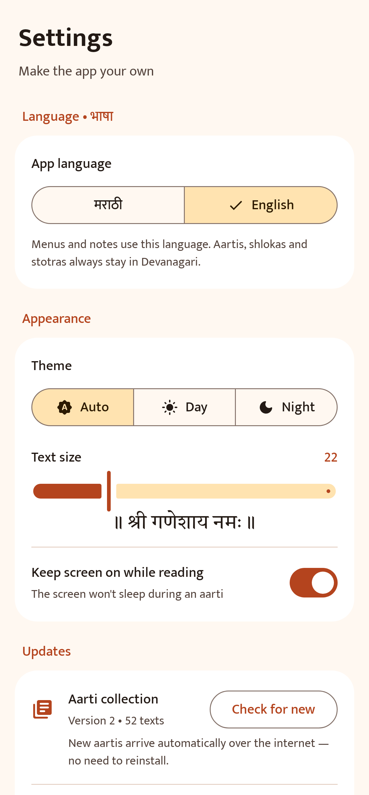

# 🪔 आरती संग्रह — Aarti Sangrah

मराठी घरांमध्ये म्हटल्या जाणाऱ्या **आरत्या, श्लोक, स्तोत्रे आणि अभंग** — देवनागरीत, सुंदर आणि सोप्या अँड्रॉइड ॲपमध्ये.
**खाते नाही • जाहिराती नाहीत • इंटरनेटशिवायही चालते.**

A free Android app with traditional Marathi Hindu aartis, shlokas, stotras and abhangs in Devanagari.
Menus in Marathi or English (the texts always stay in Devanagari). No account, no ads, no tracking,
works offline, and gets new content over the air.

<p align="center">
  
  
  
</p>
<p align="center">
  
  
  
</p>

## 📥 डाउनलोड / Download

**[नवीनतम APK डाउनलोड करा → Releases](https://github.com/nilkanth01/aarti-sangrah/releases/latest)**

फोनवर इंस्टॉल कसे करायचे:
1. वरील लिंकवरून `AartiSangrah-vX.Y.Z.apk` फाइल फोनवर डाउनलोड करा.
2. डाउनलोड झालेली फाइल उघडा.
3. "Install unknown apps / अज्ञात ॲप्स" अशी परवानगी विचारल्यास ती तुमच्या ब्राउझरला द्या.
4. **Install** दाबा. झाले! 🙏

> Android 8.0 (Oreo) किंवा नवीन फोन लागतो. ॲपचा आकार सुमारे 2.5 MB आहे.

## ✨ सुविधा / Features

- **५२ रचना** — १८ आरत्या, १८ श्लोक व मंत्र, ८ स्तोत्रे, ८ अभंग व संतवाणी
- **ॲपची भाषा: मराठी / English** — मेनू, माहिती व सेटिंग्ज इंग्रजीतही; आरत्या व श्लोक नेहमी देवनागरीतच.
  मुख्यपृष्ठावरील **English / मराठी** बटण किंवा **सेटिंग्ज → भाषा** वापरा.
  *Switch the menus to English from the home screen button or Settings → Language; the aartis stay in Devanagari.*
- **पूजा क्रम** — गणेशोत्सव आरती क्रम, सकाळचे श्लोक, सायंकाळची प्रार्थना, साई आरती — एकामागून एक स्वाइप करा
- **आजचे दैवत** — वारानुसार (सोमवार शंकर, मंगळवार गणपती…) आरत्या मुख्यपृष्ठावर
- **ध्रुपद हायलाइट** — प्रत्येक कडव्यानंतर ध्रुपद वेगळ्या रंगात, सगळ्यांना सोबत म्हणता यावे म्हणून
- **मोठी अक्षरे** — अक्षरांचा आकार हवा तसा (16–40), मराठी वळणाचा *Tiro Devanagari Marathi* फॉन्ट
- **शोध** — मराठी किंवा इंग्रजीत (`ganpati`, `ramraksha`, `सुखकर्ता`)
- **आवडते** ♡, **अलीकडे वाचलेले**, **शेअर**
- **स्क्रीन चालू ठेवा** — आरती म्हणताना फोनची स्क्रीन बंद होत नाही
- **दिवस / रात्र मोड**
- **आपोआप अपडेट** — नवीन आरत्या इंटरनेटवरून येतात; नवीन आवृत्ती आल्यास ॲप सांगते

## 📚 संग्रहात काय आहे / What's inside

| प्रकार | रचना |
|---|---|
| **आरत्या** | सुखकर्ता दुःखहर्ता, शेंदुर लाल चढायो, जय गणेश देवा, दुर्गे दुर्घट भारी, लवथवती विक्राळा, युगे अठ्ठावीस, येई हो विठ्ठले, त्रिगुणात्मक त्रैमूर्ती, आरती ज्ञानराजा, आरती तुकारामा, उत्कट साधुनि शिळा (राम), सत्राणें उड्डाणें (मारुती), ओवाळूं आरती मदनगोपाळा, आरती साईबाबा, शिर्डी माझें पंढरपूर, गजानन महाराज आरती, ॐ जय जगदीश हरे, घालीन लोटांगण |
| **श्लोक व मंत्र** | मंत्रपुष्पांजली, वक्रतुंड महाकाय, गुरुर्ब्रह्मा, कराग्रे वसते, समुद्रवसने, शुभं करोति, गायत्री मंत्र, महामृत्युंजय, कर्पूरगौरं, सर्वमंगलमांगल्ये, या कुन्देन्दु, शान्ताकारं, वसुदेवसुतं, मनोजवं, दत्त नामस्मरण, सूर्यनमस्कार मंत्र, भोजन मंत्र, शांति मंत्र |
| **स्तोत्रे** | गणपती अथर्वशीर्ष, संकटनाशन गणपती स्तोत्र, रामरक्षा, भीमरूपी (मारुती स्तोत्र), हनुमान चालीसा, शिव पंचाक्षर, श्रीरामचंद्र कृपालु, नवग्रह स्तोत्र |
| **अभंग व संतवाणी** | पसायदान, मनाचे श्लोक (१–१३), सुंदर तें ध्यान, रूप पाहतां लोचनीं, माझें माहेर पंढरी, अवघा रंग एक झाला, वृक्षवल्ली आम्हां सोयरीं, हरिपाठ |

> **पाठभेद:** या पारंपरिक रचना वेगवेगळ्या घरांत/गावांत थोड्या वेगळ्या शब्दांत म्हटल्या जातात.
> एखादी चूक आढळल्यास किंवा नवीन आरती हवी असल्यास ॲपमधील **सेटिंग्ज → चूक कळवा** वापरा, किंवा
> [येथे Issue उघडा](https://github.com/nilkanth01/aarti-sangrah/issues/new). दुरुस्ती सर्वांच्या फोनवर आपोआप पोहोचेल.

---

## 🔄 ॲप अपडेट कसे होते / How updates work

There are two kinds of updates. Most changes only need the first one.

### 1. नवीन आरत्या / दुरुस्ती — APK न बदलता (content update, no reinstall)

All texts live in one file: [`content/content.json`](content/content.json). The app ships with a copy
(so it works offline) and checks this file on GitHub at most every 6 hours, or when the user taps
**सेटिंग्ज → नवीन तपासा**.

To add or fix an aarti:
1. Edit `content/content.json` (on github.com you can click the ✏️ pencil icon).
2. **Increase `"version"` by 1** (for example `1` → `2`). Phones only download a higher version.
3. Commit to `main`. The **Check** workflow on GitHub validates the file (you'll get an email if
   something is wrong), and every phone picks it up automatically. You can also run
   `python scripts/validate_content.py` locally before pushing.

A new item looks like this (`\n` = new line, each string in `verses` is one कडवे):

```json
{
  "id": "my-new-aarti",
  "title": "आरतीचे नाव",
  "titleEn": "Aarti name in English",
  "category": "aarti",
  "deity": "ganpati",
  "author": "रचनाकार",
  "refrain": "जय देव जय देव ...।\nदुसरी ओळ॥",
  "refrainFirst": false,
  "verses": [
    "पहिल्या कडव्याची पहिली ओळ।\nदुसरी ओळ॥१॥",
    "दुसरे कडवे...॥२॥"
  ],
  "keywords": "english search words"
}
```

- `category`: `aarti`, `shlok`, `stotra` or `abhang`
- `deity`: one of the `id`s in the `deities` list (`ganpati`, `devi`, `shankar`, `vitthal`, `datta`, `ram`, `maruti`, `krishna`, `vishnu`, `sai`, `sant`, `surya`, `navgrah`, `sarva`) — you can add new deities too
- `refrain` (ध्रुपद) is optional; it is shown after every verse. `refrainFirst: true` also shows it at the top
- Optional `about` (मराठी माहिती) and `aboutEn` (the same note in English, shown when the app is in English)
- `titleEn` is shown under the Devanagari title when the app is in English, and helps English search
- New deities, categories and playlists need an English `nameEn` too (playlists and categories also take `descriptionEn`)
- To add it to a पूजा क्रम, put its `id` in a `playlists[].items` list
- Check locally with `python scripts/validate_content.py`
- If new content ever needs a newer app, set `"minAppVersion"` to that app's `versionCode`; older apps will keep their current content instead of breaking

### 2. नवीन आवृत्ती — new APK (code changes)

```powershell
.\scripts\release.ps1 -Version 1.1.0 -Notes "काय बदलले ते"
```

This bumps the version in `gradle.properties`, builds a **signed** APK, commits, tags, pushes and
creates a GitHub release with the APK attached. Every installed app then shows
**"नवीन आवृत्ती उपलब्ध"** with a download button, and the new APK installs *over* the old one
(favourites and settings are kept).

> ⚠️ **Keep the signing key safe.** Android only accepts an update if it is signed with the same key.
> The key is `C:\Users\nilkanth\AndroidDev\keys\aarti-sangrah-release.jks` and its passwords are in
> `keystore.properties` (a backup copy is next to the key). Neither is on GitHub. **Back up that
> `keys` folder** (e.g. to a pen drive or private cloud storage). If it is lost, people would have
> to uninstall and reinstall to get future versions.

---

## 🛠️ Build it yourself

Everything needed was installed into `C:\Users\nilkanth\AndroidDev` (no admin rights needed):

| Tool | Version | Location |
|---|---|---|
| JDK (Eclipse Temurin) | 17 | `AndroidDev\jdk-17` (`JAVA_HOME`) |
| Android SDK | platform 35, build-tools 35.0.0 | `AndroidDev\android-sdk` (`ANDROID_HOME`) |
| Gradle | 8.11.1 (via wrapper) | downloaded automatically |
| GitHub CLI | 2.x | `AndroidDev\gh` |

```powershell
.\gradlew.bat assembleDebug        # debug APK  -> app\build\outputs\apk\debug\
.\gradlew.bat assembleRelease      # signed APK -> app\build\outputs\apk\release\ (needs keystore.properties)
.\gradlew.bat testDebugUnitTest    # checks content.json and re-renders docs\screenshots\
```

On a new computer: install JDK 17 and the Android SDK (or Android Studio), create `local.properties`
with `sdk.dir=...`, and copy your `keystore.properties` + `.jks` to sign releases.

### Project layout

```
content/content.json        all aartis & shlokas (bundled in the APK + fetched for updates)
app/src/main/java/.../data  content loading, OTA updates, release check, settings
app/src/main/java/.../ui    Jetpack Compose screens and theme
app/src/main/res/font       Tiro Devanagari Marathi + Mukta (SIL Open Font License)
scripts/release.ps1         one-command signed release to GitHub
scripts/validate_content.py content checker (also runs on every push via .github/workflows/check.yml)
```

Tech: Kotlin, Jetpack Compose (Material 3), no third-party runtime libraries besides AndroidX.

## 🔒 Privacy

The app has no account, no ads, no analytics. It talks to only two addresses, both on GitHub:
`raw.githubusercontent.com` (new content) and `api.github.com` (is there a newer version?).
Favourites and settings never leave the phone.

## 📄 License

- Code: [MIT](LICENSE)
- Texts: traditional devotional works in the public domain
- Fonts: [Tiro Devanagari Marathi](fonts-license/OFL-TiroDevanagariMarathi.txt) and [Mukta](fonts-license/OFL-Mukta.txt), SIL Open Font License 1.1

॥ सर्वे भवन्तु सुखिनः ॥
