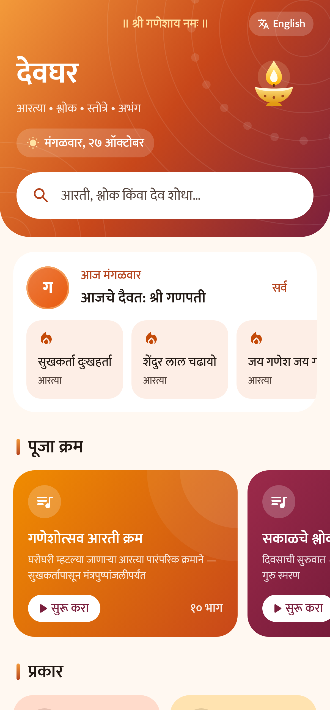
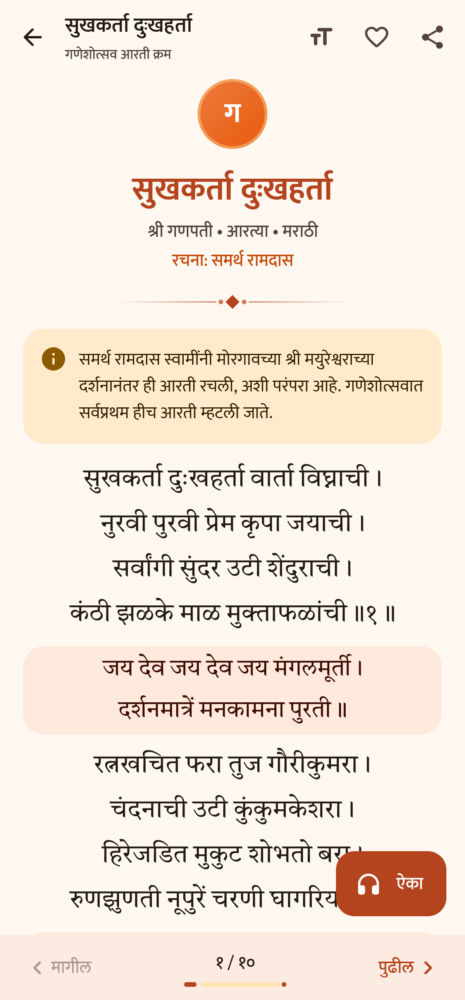
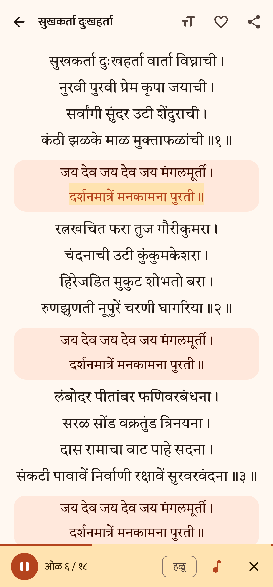
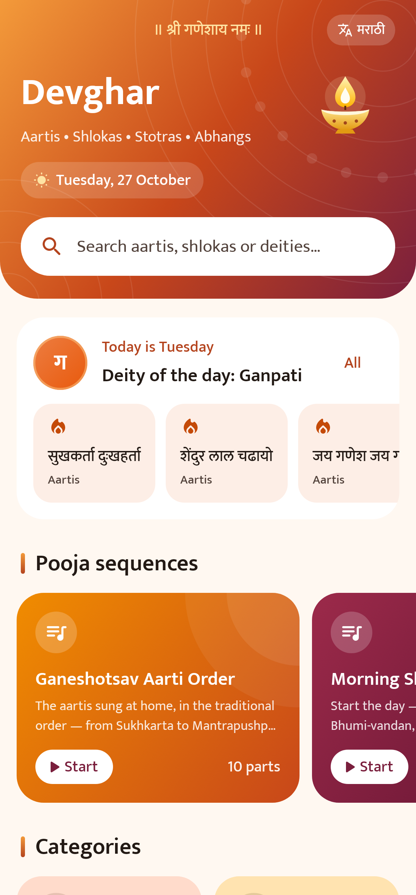
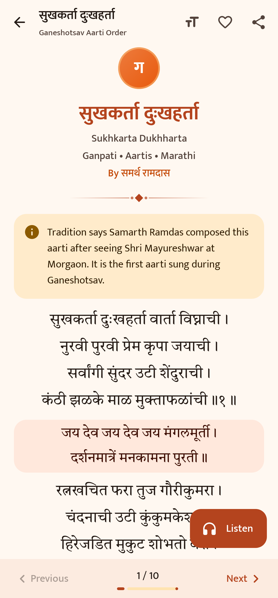
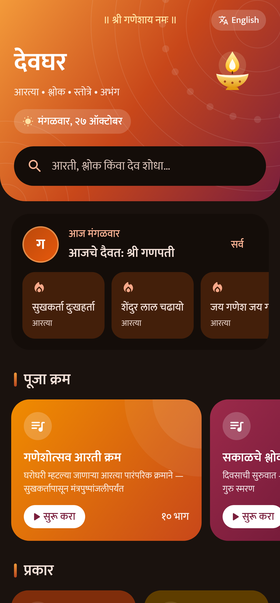

# 🪔 Devghar (देवघर)

*Formerly called Aarti Sangrah.*

A free app with the **aartis, shlokas, stotras and abhangs** sung in Marathi homes, in Devanagari,
with a clean and easy-to-use design. The menus can be in Marathi or English; the texts themselves
always stay in Devanagari.

**No account • No ads • No tracking • Works offline • New aartis arrive automatically**

<p align="center">
  
  
  
</p>
<p align="center">
  
  
  
</p>

## 📥 Download

| Phone | Get it |
|---|---|
| **Android** | **[Download the latest APK](https://github.com/nilkanth01/aarti-sangrah/releases/latest)** |
| **iPhone / iPad** | **[Open the web app](https://nilkanth01.github.io/aarti-sangrah/)**, then add it to your home screen ([steps below](#-iphone--ipad)) |

### Install on Android

1. Open the link above on your phone and download `Devghar-vX.Y.Z.apk`.
2. Open the downloaded file.
3. If the phone asks for permission to **Install unknown apps**, allow it for your browser.
4. Tap **Install**. Done! 🙏

> Needs Android 8.0 (Oreo) or newer. The app is about 2.5 MB.
> To update, install a newer APK over the old one; your favourites and settings are kept.

### 🍎 iPhone / iPad

iPhones can't install APK files, so there is a web version with the same aartis, design and language
switch. It can be kept on the home screen like a normal app and works offline after the first visit.

1. Open **[nilkanth01.github.io/aarti-sangrah](https://nilkanth01.github.io/aarti-sangrah/)** in **Safari**.
2. Tap the **Share** button (the square with an arrow pointing up).
3. Scroll down, tap **Add to Home Screen**, then tap **Add**.
4. Open the 🪔 **Devghar** app from your home screen. Done! 🙏

> The web app also works on Android phones and computers in any modern browser. It needs no App Store
> listing or Apple account, and it shows new aartis automatically because it reads the same
> `content/content.json` as the Android app. Favourites and settings are saved in that phone's browser.
> "Keep screen on" depends on the browser; it works on recent iPhones.

## ✨ Features

- **53 texts**: 18 aartis, 18 shlokas & mantras, 9 stotras, 8 abhangs
- **Listen 🎧**: tap **Listen** on any aarti or shloka and it is read aloud line by line, with a soft
  tanpura drone in the background. The line being read is highlighted, so you can follow along
  and learn the pronunciation. There is a **Slow** speed, the tanpura can be switched off, and in a
  pooja sequence it moves on to the next aarti by itself ([how the voice works](#-listen-read-aloud))
- **Marathi or English menus**: use the **English / मराठी** button on the home screen or
  **Settings → Language**. Aartis and shlokas always stay in Devanagari; in English mode each title
  also shows its English spelling
- **Pooja sequences**: Ganeshotsav aarti order, morning shlokas, evening prayers and Sai aarti; swipe
  from one to the next
- **Deity of the day**: aartis for the weekday's deity on the home screen (Monday Shankar,
  Tuesday Ganpati, …)
- **Highlighted chorus**: the refrain is shown in colour after every verse so everyone can sing along
- **Large, adjustable text** (16–40) in the *Tiro Devanagari Marathi* font, which uses Marathi letter shapes
- **Search** in English or Devanagari (`ganpati`, `ramraksha`, `सुखकर्ता`)
- **Favourites** ♡, **Recently read**, **Share**
- **Keep screen on** while reading, so the phone doesn't sleep during an aarti
- **Day / Night mode**
- **Automatic updates**: new aartis download by themselves, and the app tells you when a newer version is out

## 📚 What's inside

| Category | Texts |
|---|---|
| **Aartis** | सुखकर्ता दुःखहर्ता, शेंदुर लाल चढायो, जय गणेश जय गणेश देवा, दुर्गे दुर्घट भारी, लवथवती विक्राळा, युगे अठ्ठावीस विटेवरी उभा, येई हो विठ्ठले, त्रिगुणात्मक त्रैमूर्ती, आरती ज्ञानराजा, आरती तुकारामा, उत्कट साधुनि शिळा, सत्राणें उड्डाणें, ओवाळूं आरती मदनगोपाळा, आरती साईबाबा, शिर्डी माझें पंढरपूर, जय जय सत्चित्स्वरूपा, ॐ जय जगदीश हरे, घालीन लोटांगण |
| **Shlokas & mantras** | मंत्रपुष्पांजली, वक्रतुंड महाकाय, गुरुर्ब्रह्मा गुरुर्विष्णुः, कराग्रे वसते लक्ष्मीः, समुद्रवसने देवि, शुभं करोति कल्याणम्, गायत्री मंत्र, महामृत्युंजय मंत्र, कर्पूरगौरं करुणावतारं, सर्वमंगलमांगल्ये, या कुन्देन्दुतुषारहारधवला, शान्ताकारं भुजगशयनं, वसुदेवसुतं देवं, मनोजवं मारुततुल्यवेगं, दत्त नामस्मरण, सूर्यनमस्कार मंत्र, भोजन मंत्र, शांति मंत्र |
| **Stotras** | श्री गणपती अथर्वशीर्ष, संकटनाशन गणपती स्तोत्र, जय जयाजी गणपती, श्री रामरक्षा स्तोत्र, भीमरूपी महारुद्रा, श्री हनुमान चालीसा, शिव पंचाक्षर स्तोत्र, श्रीरामचंद्र कृपालु भजु मन, नवग्रह स्तोत्र |
| **Abhangs** | पसायदान, मनाचे श्लोक (1–13), सुंदर तें ध्यान उभें विटेवरी, रूप पाहतां लोचनीं, माझें माहेर पंढरी, अवघा रंग एक झाला, वृक्षवल्ली आम्हां सोयरीं वनचरें, हरिपाठ — देवाचिये द्वारीं |

> **Variations in wording:** these traditional texts are sung with small differences from family to family
> and village to village. If you spot a mistake or want an aarti added, use **Settings → Report a mistake**
> in the app or [open an issue here](https://github.com/nilkanth01/aarti-sangrah/issues/new).
> Corrections reach everyone's phone automatically.

## 🎧 Listen (read aloud)

**Listen** uses the phone's own text-to-speech voice. Nothing extra is downloaded by the app and it
works offline once the voice is on the phone. Marathi texts (and Sanskrit, read the Marathi way) use a
Marathi voice; Hindi texts such as श्री हनुमान चालीसा use a Hindi voice. If only one of the two voices
is installed, it is used for everything.

| Phone | What to do |
|---|---|
| **Android** | Usually works straight away. If the app says the Marathi voice is missing: **Settings → Accessibility (or System) → Text-to-speech → Google Speech Services → ⚙️ → Install voice data → Marathi**. The app's **Settings → Listen → Open voice settings** takes you there. |
| **iPhone / iPad** (web app) | iPhones usually have no Marathi voice, so the web app uses the Hindi voice, which reads Devanagari well; the app says so while it plays. If your iPhone does have a Marathi voice, it is used. |
| **Computer** (web app) | Microsoft Edge has natural Marathi voices; Chrome on Windows usually has none, so it falls back to Hindi where available. |

This is a computer voice reading the words, so it is good for learning how each word is said, but it
doesn't sing the tune. The tanpura in the background is generated by `scripts/make_tanpura.py`
(no recordings are used).

---

## 🔄 How updates work

There are two kinds of updates. Most changes only need the first one.

### 1. New or corrected aartis (no reinstall needed)

All texts live in one file: [`content/content.json`](content/content.json). The Android app ships with a
copy (so it works offline) and checks this file on GitHub at most every 6 hours, or when someone taps
**Settings → Check for new**. The web app reads the same file whenever it is online.

To add or fix an aarti:
1. Edit `content/content.json` (on github.com you can click the ✏️ pencil icon).
2. **Increase `"version"` by 1** (for example `2` → `3`). Phones only download a higher version.
3. Commit to `main`. The **Check** workflow on GitHub validates the file (you'll get an email if
   something is wrong), the web app is republished, and every phone picks up the change automatically.
   You can also run `python scripts/validate_content.py` locally before pushing.

A new item looks like this (`\n` starts a new line; each string in `verses` is one stanza):

```json
{
  "id": "my-new-aarti",
  "title": "सुखकर्ता दुःखहर्ता",
  "titleEn": "Sukhkarta Dukhharta",
  "category": "aarti",
  "deity": "ganpati",
  "author": "Composer's name in Devanagari",
  "about": "Optional note in Marathi",
  "aboutEn": "Optional note in English",
  "refrain": "First line of the chorus।\nSecond line॥",
  "refrainFirst": false,
  "verses": [
    "First stanza, line one।\nline two॥१॥",
    "Second stanza…॥२॥"
  ],
  "keywords": "english search words"
}
```

- `category`: `aarti`, `shlok`, `stotra` or `abhang`
- `deity`: one of the `id`s in the `deities` list (`ganpati`, `devi`, `shankar`, `vitthal`, `datta`, `ram`,
  `maruti`, `krishna`, `vishnu`, `sai`, `sant`, `surya`, `navgrah`, `sarva`); you can add new deities too
- `refrain` (the chorus) is optional and is shown after every verse; `refrainFirst: true` also shows it at the top
- `about` / `aboutEn` are optional notes, shown in the app's chosen language
- `titleEn` is shown under the Devanagari title in English mode and helps English search
- New deities, categories and playlists need an English `nameEn` too (playlists and categories also take `descriptionEn`)
- To add an item to a pooja sequence, put its `id` in that entry's `playlists[].items` list
- If new content ever needs a newer app, set `"minAppVersion"` to that app's `versionCode`; older apps then
  keep their current content instead of breaking

### 2. A new app version (code changes)

```powershell
.\scripts\release.ps1 -Version 1.2.0 -Notes "What changed"
.\scripts\release.ps1 -Version 1.2.0 -NotesFile notes.md   # longer notes from a UTF-8 file
```

This bumps the version in `gradle.properties`, builds a **signed** APK, commits, tags, pushes and creates
a GitHub release with the APK attached. Every installed Android app then shows a **new version available**
message with a download button, and the new APK installs *over* the old one (favourites and settings are kept).

> ⚠️ **Keep the signing key safe.** Android only accepts an update if it is signed with the same key.
> The key is `C:\Users\nilkanth\AndroidDev\keys\aarti-sangrah-release.jks` and its passwords are in
> `keystore.properties` (a backup copy is next to the key). Neither is on GitHub. **Back up that
> `keys` folder** (for example to a pen drive or private cloud storage). If it is lost, people would
> have to uninstall and reinstall to get future versions.

---

## 🛠️ Build it yourself

Everything needed was installed into `C:\Users\nilkanth\AndroidDev` (no admin rights needed):

| Tool | Version | Location |
|---|---|---|
| JDK (Eclipse Temurin) | 17 | `AndroidDev\jdk-17` (`JAVA_HOME`) |
| Android SDK | platform 35, build-tools 35.0.0 | `AndroidDev\android-sdk` (`ANDROID_HOME`) |
| Gradle | 8.11.1 (via wrapper) | downloaded automatically |
| GitHub CLI | 2.x | `AndroidDev\gh` |

```powershell
.\gradlew.bat assembleDebug        # debug APK  -> app\build\outputs\apk\debug\
.\gradlew.bat assembleRelease      # signed APK -> app\build\outputs\apk\release\ (needs keystore.properties)
.\gradlew.bat testDebugUnitTest    # checks content.json, re-renders docs\screenshots\ and web\icons\
```

On a new computer: install JDK 17 and the Android SDK (or Android Studio), create `local.properties`
with `sdk.dir=...`, and copy your `keystore.properties` + `.jks` to sign releases.

### Project layout

```
content/content.json        all aartis & shlokas (bundled in the APK + fetched for updates)
app/src/main/java/.../data  content loading, OTA updates, release check, settings
app/src/main/java/.../ui    Jetpack Compose screens, theme and the Marathi/English strings
app/src/main/res/font       Tiro Devanagari Marathi + Mukta (SIL Open Font License)
web/                        iPhone / web app: index.html, app.css, app.js, sw.js (offline), icons
scripts/build_web.py        assembles web/ + content.json + fonts + tanpura into build/site
scripts/make_tanpura.py     generates the background tanpura drone (app/src/main/res/raw/tanpura.wav)
scripts/release.ps1         one-command signed release to GitHub
scripts/validate_content.py content checker (also runs on every push via .github/workflows/check.yml)
```

Tech: Kotlin, Jetpack Compose (Material 3), no third-party runtime libraries besides AndroidX.
The web app is plain HTML/CSS/JavaScript with no libraries or build tools.

### Web app

`.github/workflows/pages.yml` rebuilds and publishes the web app to GitHub Pages on every push to `main`,
so a `content.json` change reaches Android users (over the air) and web users at the same time.
Each deploy stamps a new build id into `sw.js`, so installed copies update themselves the next time
they are opened. To try it locally:

```powershell
python scripts\build_web.py
python -m http.server 8765 -d build\site    # then open http://localhost:8765
```

The web app's menu text lives in `web/app.js` and the Android app's in `ui/Strings.kt`; change both
when you edit a label.

## 🔒 Privacy

The app has no account, no ads and no analytics. The Android app talks to only two addresses, both on
GitHub: `raw.githubusercontent.com` (new content) and `api.github.com` (is there a newer version?).
The web app only loads its own files from `nilkanth01.github.io`. Favourites and settings never leave the phone.

## 📄 License

- Code: [MIT](LICENSE)
- Texts: traditional devotional works in the public domain
- Fonts: [Tiro Devanagari Marathi](fonts-license/OFL-TiroDevanagariMarathi.txt) and [Mukta](fonts-license/OFL-Mukta.txt), SIL Open Font License 1.1
- Icons: Material Icons by Google, Apache License 2.0

॥ सर्वे भवन्तु सुखिनः ॥
